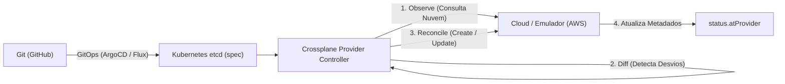

# Guia Completo: Crossplane no Kubernetes (k3s / Cloud)

Este repositório contém uma arquitetura de referência para entrega contínua e GitOps utilizando **Crossplane** e **Kubernetes**, integrando aplicações conteinerizadas (workloads) e recursos de infraestrutura de nuvem (AWS / Emulador Local) no mesmo ciclo de vida declarativo.

---

## 📁 Estrutura do Repositório

```text
.
├── README.md
├── manifests/
│   ├── app-with-crossplane-s3.yaml     # Aplicação (Namespace, ConfigMap, Deployment, Service) + Bucket S3 em arquivo único
│   ├── dynamodb-table.yaml             # Tabela DynamoDB declarativa via Crossplane (Upbound)
│   ├── redis-cluster.yaml              # Cluster Redis / ElastiCache declarativo via Crossplane (Upbound)
│   └── crossplane-provider-aws.yaml    # Secret de Credenciais + ProviderConfig (apontado para emulador local)
└── helm/
    └── my-app/
        ├── Chart.yaml
        ├── values.yaml                 # Exemplo completo parametrizando Aplicação e Infraestrutura Crossplane
        └── templates/
            ├── _helpers.tpl
            ├── app-deployment.yaml     # Deployment do workload
            ├── app-service.yaml        # Service do workload
            ├── app-configmap.yaml      # ConfigMap da aplicação
            ├── crossplane-s3.yaml      # Template condicional para Bucket S3
            ├── crossplane-dynamodb.yaml# Template condicional para Tabela DynamoDB
            └── crossplane-redis.yaml   # Template condicional para ElastiCache Redis
```

---

## 🚀 1. Instalação do Crossplane com Helm

O Crossplane transforma seu cluster Kubernetes em um **Universal Control Plane**, permitindo provisionar recursos fora do cluster (S3, RDS, DynamoDB, Redis, etc.) usando a mesma API declarativa (`kubectl`, Helm, ArgoCD, Flux).

### Passo a Passo de Instalação:

```bash
# 1. Adicionar o repositório Helm oficial do Crossplane
helm repo add crossplane-stable https://charts.crossplane.io/stable
helm repo update

# 2. Instalar o Crossplane no namespace crossplane-system
helm upgrade --install crossplane \
  --namespace crossplane-system \
  --create-namespace \
  crossplane-stable/crossplane \
  --wait
```

### Validando a Instalação:

```bash
kubectl get pods -n crossplane-system
# Saída esperada:
# NAME                                      READY   STATUS    RESTARTS   AGE
# crossplane-bf6c48dd5-74q5r                1/1     Running   0          5m
# crossplane-rbac-manager-c67db7f5b-8ncmz   1/1     Running   0          5m
```

---

## ⚙️ 2. Instalação e Configuração dos Providers Upbound

Os Providers do Crossplane são controladores que estendem a API do Kubernetes com CRDs específicos de cada provedor (ex: AWS, GCP, Azure, Vault).

### 2.1 Instalando os Providers (S3, DynamoDB e ElastiCache):

```yaml
apiVersion: pkg.crossplane.io/v1
kind: Provider
metadata:
  name: provider-aws-s3
spec:
  package: xpkg.upbound.io/upbound/provider-aws-s3:v1.14.0
---
apiVersion: pkg.crossplane.io/v1
kind: Provider
metadata:
  name: provider-aws-dynamodb
spec:
  package: xpkg.upbound.io/upbound/provider-aws-dynamodb:v1.14.0
---
apiVersion: pkg.crossplane.io/v1
kind: Provider
metadata:
  name: provider-aws-elasticache
spec:
  package: xpkg.upbound.io/upbound/provider-aws-elasticache:v1.14.0
```

Para aplicar:
```bash
kubectl apply -f <manifesto-providers>.yaml
kubectl wait --for=condition=Healthy provider/provider-aws-s3 --timeout=120s
kubectl wait --for=condition=Healthy provider/provider-aws-dynamodb --timeout=120s
kubectl wait --for=condition=Healthy provider/provider-aws-elasticache --timeout=120s
```

### 2.2 Configurando o `ProviderConfig`:

O `ProviderConfig` define como os controladores se autenticam e onde enviam as chamadas de API.

- **Para Emulador Local / LocalStack (`manifests/crossplane-provider-aws.yaml`)**:
  Aponta as chamadas para o serviço interno do emulador no cluster (`http://aws-emulator.default.svc.cluster.local:4566`) com `skip_credentials_validation: true` e `s3_use_path_style: true`.
- **Para AWS Real em Produção (EKS / k3s com OIDC)**:
  Utiliza-se **IRSA (IAM Roles for Service Accounts)** ou Pod Identity, eliminando credenciais estáticas:
  ```yaml
  apiVersion: aws.upbound.io/v1beta1
  kind: ProviderConfig
  metadata:
    name: default
  spec:
    credentials:
      source: InjectedIdentity
  ```

---

## 📦 3. Manifestos Práticos

### 3.1 Aplicação + S3 no mesmo arquivo YAML (`manifests/app-with-crossplane-s3.yaml`)
Permite que o time de desenvolvimento entregue no mesmo PR do GitHub:
- O Namespace da aplicação (`demo-crossplane`).
- O ConfigMap com arquivos estáticos.
- O Deployment do NGINX.
- O Service interno.
- O Bucket S3 (`validando-crossplane-bucket`) gerenciado pelo Crossplane.

```bash
kubectl apply -f manifests/app-with-crossplane-s3.yaml
```

### 3.2 Tabela DynamoDB (`manifests/dynamodb-table.yaml`)
Provisiona uma tabela DynamoDB em modo sob demanda (`PAY_PER_REQUEST`) com chaves de partição e ordenação (`hashKey: id`, `rangeKey: createdAt`) e exporta os dados de conexão para uma Secret K8s via `writeConnectionSecretToRef`.

```bash
kubectl apply -f manifests/dynamodb-table.yaml
```

### 3.3 Cluster Redis / ElastiCache (`manifests/redis-cluster.yaml`)
Provisiona um cluster Redis (AWS ElastiCache v7.0) e injeta automaticamente as credenciais e endpoint de conexão em uma Secret no namespace da aplicação.

```bash
kubectl apply -f manifests/redis-cluster.yaml
```

---

## ⎈ 4. Abstração com Helm Chart (`helm/my-app/`)

Em ambientes corporativos e plataformas de engenharia (Internal Developer Platforms - IDP), desenvolvedores não precisam escrever CRDs complexos do Crossplane. Eles apenas preenchem um arquivo `values.yaml`:

```yaml
# Trecho do values.yaml
app:
  name: nginx-hello
  replicaCount: 2
  image:
    repository: nginx
    tag: alpine

crossplane:
  enabled: true
  providerConfigRef: default
  deletionPolicy: Delete
  s3:
    enabled: true
    bucketName: "my-app-storage-bucket"
  dynamodb:
    enabled: true
    tableName: "my-app-orders-table"
  redis:
    enabled: true
    clusterName: "my-app-redis-cache"
```

### Testando e Instalando o Chart:
```bash
# Renderizar os manifestos localmente para validação
helm template my-release helm/my-app/

# Fazer o deploy completo da aplicação e das dependências de nuvem
helm upgrade --install my-app helm/my-app/ --namespace demo-crossplane --create-namespace
```

---

## 🔍 5. Como Gerenciar e Inspecionar os Objetos Criados

O Crossplane segue rigorosamente as convenções da API do Kubernetes.

### 5.1 Comandos Essenciais

```bash
# Listar TODOS os recursos gerenciados pelo Crossplane em um único comando:
kubectl get managed

# Listar por tipo de recurso:
kubectl get buckets.s3.aws.upbound.io
kubectl get tables.dynamodb.aws.upbound.io
kubectl get clusters.elasticache.aws.upbound.io

# Inspecionar detalhes aprofundados de um objeto:
kubectl describe bucket validando-crossplane-bucket
kubectl describe table demo-dynamo-table
```

### 5.2 Entendendo as Condições (`Conditions`):

Na saída do `kubectl get managed`, você verá duas colunas críticas:

```text
NAME                                                   SYNCED   READY   EXTERNAL-NAME                 AGE
bucket.s3.aws.upbound.io/validando-crossplane-bucket   True     True    validando-crossplane-bucket   15m
table.dynamodb.aws.upbound.io/demo-dynamo-table        True     True    demo-dynamo-table             2m
```

| Condição | Status | Significado |
| :--- | :--- | :--- |
| **`SYNCED`** | `True` | O controlador do Crossplane conseguiu processar o manifesto, autenticar no provedor de nuvem e enviar as chamadas de API sem erros de sintaxe ou permissão. |
| **`SYNCED`** | `False` | Houve erro de comunicação, autenticação, endpoint incorreto ou parâmetros inválidos. Inspecione com `kubectl describe`. |
| **`READY`** | `True` | O recurso físico na nuvem/emulador foi criado com sucesso e está operacional (ex: bucket criado, tabela ativa, réplicas sincronizadas). |
| **`READY`** | `False` | O recurso ainda está em processo de criação na nuvem (ex: ElastiCache provisionando nós) ou falhou. |

### 5.3 Inspecionando o `status.atProvider` e `external-name`:

- **`metadata.annotations["crossplane.io/external-name"]`**: Nome real do recurso na nuvem.
- **`status.atProvider`**: Contém todos os atributos retornados pela nuvem em tempo real (ARNs, hosted zone IDs, status de encriptação, endpoints):
  ```bash
  kubectl get bucket validando-crossplane-bucket -o jsonpath='{.status.atProvider.arn}'
  # Retorno: arn:aws:s3:::validando-crossplane-bucket
  ```

### 5.4 Troubleshooting e Diagnóstico de Erros

Se um recurso estiver com `SYNCED=False` ou `READY=False`:
1. Verifique os eventos do recurso:
   ```bash
   kubectl describe <kind> <nome> | grep -A 10 Events:
   ```
2. Verifique os logs do pod do controlador responsável no namespace `crossplane-system`:
   ```bash
   kubectl logs -n crossplane-system -l pkg.crossplane.io/provider=provider-aws-s3 --tail=50
   kubectl logs -n crossplane-system -l pkg.crossplane.io/provider=provider-aws-dynamodb --tail=50
   ```

---

## 🧠 6. Como Funciona o State (Estado) no Crossplane

Uma das principais dúvidas de quem migra do **Terraform** para o **Crossplane** é: *"Onde fica salvo o arquivo `.tfstate`?"*

### 6.1 Terraform State vs Crossplane State

| Característica | Terraform Tradicional | Crossplane (Kubernetes Native) |
| :--- | :--- | :--- |
| **Onde fica o State?** | Em um arquivo estático (`terraform.tfstate`) em bucket S3 ou Terraform Cloud. | **Não existe arquivo `.tfstate`!** O estado desejado fica no `etcd` do K8s (no `spec`). O estado real fica no `status.atProvider`. |
| **Bloqueio de Concorrência (Locking)** | Lock explícito via DynamoDB ou backend HTTP. Se travar, exige desbloqueio manual. | Mecanismo nativo de concorrência otimista do Kubernetes (`generation`, `resourceVersion`). Múltiplos operadores podem atuar sem travar. |
| **Reconciliação e Drift** | **Estática/Manual**: Só roda quando alguém aciona a pipeline ou `terraform apply`. Desvios na nuvem não são percebidos automaticamente. | **Ativa/Contínua (Reconciliation Loop)**: O Crossplane consulta a nuvem a cada ~60 segundos. Se alguém alterar algo manualmente no console da nuvem, o Crossplane reverte para o estado declarado no Git (Drift Detection nativo). |
| **Entrega com Aplicações** | Pipeline de Infra separada da Pipeline de App. Dificuldade de sincronismo. | **Atômica**: A aplicação e suas dependências de nuvem sobem juntas no mesmo `kubectl apply` ou `helm install`. |

### 6.2 O Ciclo de Reconciliação Contínua (Reconcile Loop)



1. **Observe**: O controlador pergunta à API da AWS se o recurso existe e quais são seus atributos atuais.
2. **Diff**: Compara o que foi retornado com o que está declarado no `spec`.
3. **Reconcile**: Se houver divergência, aciona a API da nuvem para ajustar. Se o recurso não existir, cria.
4. **Update Status**: Grava as informações retornadas da nuvem no `status.atProvider` do objeto no Kubernetes.

### 6.3 Políticas de Exclusão (`deletionPolicy`)

Ao definir um recurso gerenciado, você escolhe o que acontece na nuvem quando o manifesto é excluído do Kubernetes:

```yaml
spec:
  deletionPolicy: Delete # Opções: Delete ou Orphan
```

- **`Delete` (Padrão para Dev/Staging)**: Se o recurso no Kubernetes for deletado (`kubectl delete bucket ...`), o Crossplane envia comando para **destruir o recurso físico na nuvem**.
- **`Orphan` (Recomendado para Produção/Bancos de Dados)**: Se o recurso no Kubernetes for deletado acidentalmente, o Crossplane remove o objeto do Kubernetes, mas **mantém o recurso na nuvem intacto** (evita perda de dados em S3, DynamoDB, RDS).

### 6.4 Finalizers do Kubernetes

O Crossplane adiciona automaticamente o finalizer `finalizer.managedresource.crossplane.io` aos recursos gerenciados. Isso garante que:
- O Kubernetes não remove o objeto do `etcd` até que o controlador do Crossplane confirme que o recurso na nuvem foi devidamente excluído (ou liberado, se for `Orphan`).
- Evita que fiquem "recursos zumbis" na nuvem gerando custos sem representação no cluster.

### 6.5 Injeção Automática de Segredos (`writeConnectionSecretToRef`)

Quando o Crossplane provisiona um recurso com credenciais ou endpoints dinâmicos (como senhas de banco de dados, endpoints do Redis ou chaves de acesso), ele pode gravar essas informações diretamente em uma `Secret` do Kubernetes:

```yaml
spec:
  writeConnectionSecretToRef:
    namespace: demo-crossplane
    name: redis-conn-secret
```

Sua aplicação pode simplesmente consumir essa Secret via `envFrom`:
```yaml
containers:
- name: app
  envFrom:
  - secretRef:
      name: redis-conn-secret
```
Nenhum operador humano precisa copiar e colar credenciais entre o console da nuvem e o Kubernetes.

---

## 🧪 7. Ambiente de Testes Local: AWS Emulator no Debian

Para validar o provisionamento do Crossplane sem custos e sem necessidade de conexão com a AWS pública, o ambiente deste laboratório utilizou o **AWS Emulator** rodando nativamente no Debian (host) integrado ao cluster `k3s`.

### 7.1 Como Instalar no Debian

O emulador é distribuído em pacote `.deb` para Linux AMD64:

```bash
# Instalação do pacote .deb no Debian / Ubuntu
sudo dpkg -i /tmp/aws-emulator_1.0.367-1_amd64.deb
# Ou resolvendo eventuais dependências:
sudo apt-get install -f
```

O binário fica localizado no path do sistema ou em `/home/system_space/opt/aws-emulator/bin/aws-emulator`.

### 7.2 Modos de Execução e Recuperação de Credenciais

O emulador suporta dois modos principais de operação:

#### Modo 1: Com Autenticação SigV4 (Padrão)
Por padrão, o emulador exige assinaturas SigV4 e gera credenciais exclusivas e certificados a cada execução:

```bash
aws-emulator --bind 127.0.0.1 --port 9297
```

**Como recuperar as credenciais geradas:**
As credenciais e configurações da AWS CLI são salvas automaticamente na pasta home do usuário:
```bash
# Visualizar o arquivo de credenciais (Access Key e Secret Key):
cat ~/.aws/emulator/9297/emulator_credentials

# Visualizar o arquivo de configuração e CA bundle:
cat ~/.aws/emulator/9297/config
```

Para usar a AWS CLI apontando para esse perfil:
```bash
AWS_CONFIG_FILE=~/.aws/emulator/9297/config \
AWS_SHARED_CREDENTIALS_FILE=~/.aws/emulator/9297/emulator_credentials \
aws s3 ls
```

#### Modo 2: Sem Autenticação e Acesso em Rede (Recomendado para Kubernetes / Crossplane)
Para permitir que o Crossplane dentro do cluster `k3s` provisione recursos usando credenciais estáticas dummy (`test`/`test`) e acesse o emulador via rede:

```bash
# Iniciar em background escutando em todas as interfaces com autenticação desligada:
setsid /home/system_space/opt/aws-emulator/bin/aws-emulator \
  --bind 0.0.0.0 \
  --auth off \
  --port 9297 </dev/null >/tmp/aws-emulator.log 2>&1 &
```

**Validar a saúde do emulador:**
```bash
curl -k https://127.0.0.1:9297/__admin/health
# Retorno esperado: 200 OK com corpo "ok"
```

### 7.3 Integração com o Kubernetes (Ponte HTTP)

Como o emulador utiliza TLS com certificado autoassinado na porta `9297`, os pods do Crossplane dentro do cluster podem ter restrições de validação x509. Para resolver isso de forma elegante e desacoplada, disponibilizamos um proxy reverso NGINX interno no cluster:

```bash
# Endpoint interno acessível por qualquer pod ou Provider do Crossplane:
http://aws-emulator.default.svc.cluster.local:4566
```

Esse proxy aceita conexões HTTP planas no padrão LocalStack (porta `4566`) e encaminha para `https://<IP_DO_HOST>:9297` com `proxy_ssl_verify off`.

### 7.4 Criando Objetos e Consultando Resultados Práticos

Com a autenticação desligada (`--auth off`), você pode usar a AWS CLI informando credenciais dummy diretamente via variáveis de ambiente ou flags:

#### A) Testando o Amazon S3

```bash
# 1. Criar um Bucket S3:
AWS_ACCESS_KEY_ID=test AWS_SECRET_ACCESS_KEY=test AWS_DEFAULT_REGION=us-east-1 \
  aws --endpoint-url=https://127.0.0.1:9297 --no-verify-ssl s3 mb s3://meu-bucket-local

# 2. Fazer Upload de um Arquivo:
echo "Crossplane + AWS Emulator" > /tmp/hello.txt
AWS_ACCESS_KEY_ID=test AWS_SECRET_ACCESS_KEY=test AWS_DEFAULT_REGION=us-east-1 \
  aws --endpoint-url=https://127.0.0.1:9297 --no-verify-ssl s3 cp /tmp/hello.txt s3://meu-bucket-local/hello.txt

# 3. Listar Buckets Existentes (incluindo os criados pelo Crossplane):
AWS_ACCESS_KEY_ID=test AWS_SECRET_ACCESS_KEY=test AWS_DEFAULT_REGION=us-east-1 \
  aws --endpoint-url=https://127.0.0.1:9297 --no-verify-ssl s3 ls

# 4. Listar os Objetos do Bucket:
AWS_ACCESS_KEY_ID=test AWS_SECRET_ACCESS_KEY=test AWS_DEFAULT_REGION=us-east-1 \
  aws --endpoint-url=https://127.0.0.1:9297 --no-verify-ssl s3 ls s3://meu-bucket-local/
```

#### B) Testando o Amazon DynamoDB

```bash
# 1. Criar uma Tabela DynamoDB:
AWS_ACCESS_KEY_ID=test AWS_SECRET_ACCESS_KEY=test AWS_DEFAULT_REGION=us-east-1 \
  aws --endpoint-url=https://127.0.0.1:9297 --no-verify-ssl dynamodb create-table \
    --table-name clientes \
    --attribute-definitions AttributeName=id,AttributeType=S \
    --key-schema AttributeName=id,KeyType=HASH \
    --billing-mode PAY_PER_REQUEST

# 2. Inserir um Registro (Item):
AWS_ACCESS_KEY_ID=test AWS_SECRET_ACCESS_KEY=test AWS_DEFAULT_REGION=us-east-1 \
  aws --endpoint-url=https://127.0.0.1:9297 --no-verify-ssl dynamodb put-item \
    --table-name clientes \
    --item '{"id": {"S": "cli-001"}, "nome": {"S": "Rogerio"}, "role": {"S": "DevOps"}}'

# 3. Listar as Tabelas Criadas:
AWS_ACCESS_KEY_ID=test AWS_SECRET_ACCESS_KEY=test AWS_DEFAULT_REGION=us-east-1 \
  aws --endpoint-url=https://127.0.0.1:9297 --no-verify-ssl dynamodb list-tables

# 4. Consultar os Dados Inseridos (Scan):
AWS_ACCESS_KEY_ID=test AWS_SECRET_ACCESS_KEY=test AWS_DEFAULT_REGION=us-east-1 \
  aws --endpoint-url=https://127.0.0.1:9297 --no-verify-ssl dynamodb scan \
    --table-name clientes
```

#### C) Testando o Amazon ElastiCache

```bash
# Consultar os clusters ElastiCache gerenciados:
AWS_ACCESS_KEY_ID=test AWS_SECRET_ACCESS_KEY=test AWS_DEFAULT_REGION=us-east-1 \
  aws --endpoint-url=https://127.0.0.1:9297 --no-verify-ssl elasticache describe-cache-clusters
```

